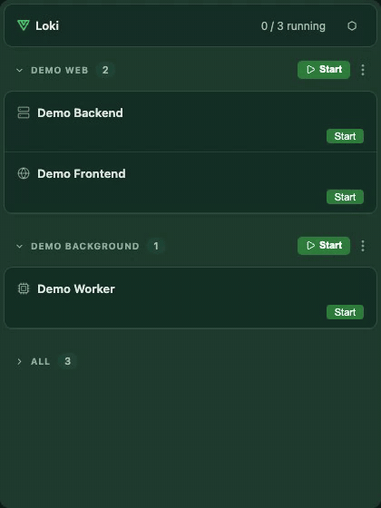
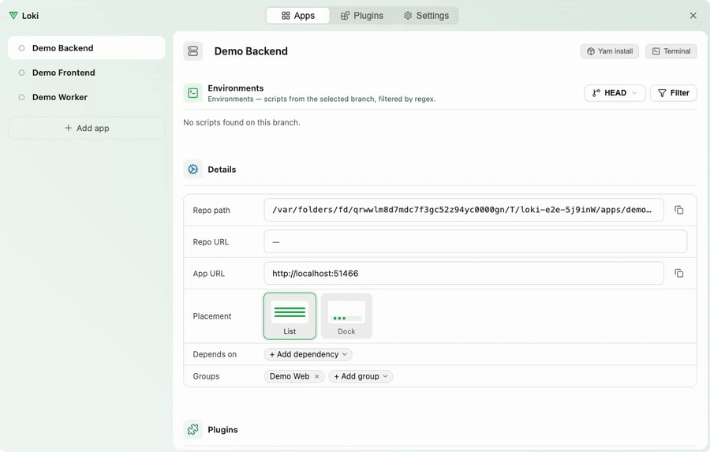
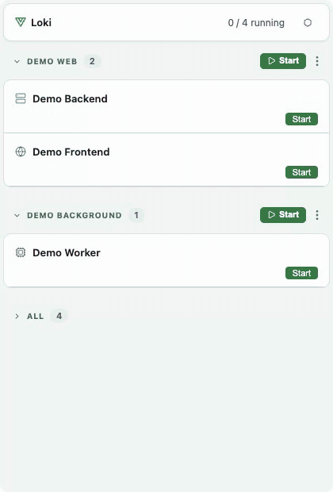

# Loki Orchestrator

A tray app for running many local repositories at once. Loki starts and stops
each app's dev server, switches its Git branch (stashing your uncommitted work
and bringing it back later), and lets you pick which `package.json` script it
runs. Everything stays on your machine; there is no remote server.

It is built for people who work on several microfrontends or services at the
same time and are tired of keeping a terminal tab per repo.

## Contents

- [See it in action](#see-it-in-action)
- [Features](#features)
- [Install](#install)
- [Quick start](#quick-start)
- [Documentation](#documentation)
- [How it works](#how-it-works)
- [Contributing](#contributing)
- [License](#license)

## See it in action

**Start and stop apps from the tray.** Starting a group brings up its apps in
dependency order (the frontend waits for the backend); each row shows the port
it listens on.

**Add an app.** Drop a project folder onto the Workspace window: Loki adds it,
reads its `package.json` scripts into Environments and fills in the details.

**Themes.** Light or dark, Solid or Glass, and five tints, in Settings →
Appearance.

## Features

- **Start, stop and restart** every app from one list, with live status and
  the port it listens on. An app can depend on others, which then start first.
- **Branch switching per app.** Uncommitted changes are stashed for the old
  branch and re-applied when you come back to it.
- **Environments.** The scripts in an app's `package.json` become a picker
  (`start`, `dev:staging`, …), optionally filtered by a regular expression.
- **Groups and favorites.** Put apps into groups, start or stop a whole group,
  reorder by drag and drop, search.
- **Two ways to run processes.** tmux (macOS and Linux; attach to the live
  output from any terminal) or plain background processes with log files
  (every OS).
- **Plugins.** Small TypeScript modules that add buttons, toggles or menu items
  to app rows. Five ship with Loki, including Git fetch/pull/push.

## Install

Download the installer for your computer from the
[latest release](https://github.com/liubomyr-kozak/Loki/releases/latest):

| Your computer | File |
|---|---|
| Mac with Apple Silicon (M1 or newer) | `Loki_<version>_aarch64.dmg` |
| Mac with an Intel CPU | `Loki_<version>_x64.dmg` |
| Windows 10/11, 64-bit | `Loki_<version>_x64-setup.exe` |

Not sure which Mac you have? Apple menu → **About This Mac**: "Chip: Apple…"
means Apple Silicon, "Processor: Intel…" means Intel.

- **macOS:** open the `.dmg` and drag **Loki** into **Applications**. The app is
  not notarized by Apple, so the first launch is blocked; follow
  [macOS says Loki can't be opened](wiki/guides/troubleshooting.md#macos-says-loki-not-opened-or-cant-be-opened-or-is-damaged).
- **Windows:** run the `-setup.exe`. It installs for your user only, no admin
  rights needed. If SmartScreen warns, see
  [Windows protected your PC](wiki/guides/troubleshooting.md#windows-protected-your-pc-smartscreen).

The installer carries its own Node.js, so Loki needs nothing else to run. The
repositories you manage still need their own tools (Git, Node, Yarn, …).

There is no Linux installer yet; on Linux, [run Loki from source](wiki/guides/development.md).

## Quick start

1. Start Loki. No window opens: it lives in the menu bar (macOS) or the tray
   (Windows). Click its icon to open the launcher.
2. With no apps yet, the launcher shows **Open Workspace**. Click it to open
   the Workspace window, then on its **Apps** tab click **Add app** and pick
   the folder of a local Git repository.
3. Loki reads the folder's `package.json`, proposes a start script and adds the
   app. Install the repository's own dependencies first.
4. Back in the launcher, press **Start** on the app's row. When the port shows
   up, the app is running.

The [getting started guide](wiki/guides/getting-started.md) walks through this with
the bundled demo apps, including branch switching and groups.

## Documentation

| I want to… | Read |
|---|---|
| Set up Loki and run a first app | [Getting started](wiki/guides/getting-started.md) |
| Learn every screen and feature | [User guide](wiki/guides/user-guide.md) |
| Look up a config field, file or environment variable | [Configuration reference](wiki/guides/configuration.md) |
| Write or install a plugin | [Plugins](wiki/guides/plugins.md) |
| Fix an install, launch or build problem | [Troubleshooting](wiki/guides/troubleshooting.md) |
| Build Loki from source, run the tests | [Development](wiki/guides/development.md) |
| Understand how the pieces fit together | [Architecture](wiki/guides/architecture.md) |
| Publish a release or build an installer | [Releasing](wiki/guides/releasing.md) |

All documentation lives in the [wiki](wiki/index.md): the pages above are in
[wiki/guides/](wiki/guides/index.md), next to the module-by-module design
notes.

## How it works

Loki has two parts that talk only over HTTP on `http://127.0.0.1:9999`:

- a **backend** in Node.js and TypeScript (`app/backend/`) that owns the
  config, starts and watches processes, runs Git and hosts plugins;
- a **desktop shell** in Tauri v2 (`app/src-tauri/`, Rust) around a React 19 +
  Redux Toolkit UI (`app/src/`). In an installed app the shell starts the
  backend with the bundled Node.js.

More in [Architecture](wiki/guides/architecture.md).

## Contributing

Issues and pull requests are welcome. See [CONTRIBUTING.md](CONTRIBUTING.md)
for the branch and commit rules and the checks to run before opening a pull
request.

## License

[MIT](LICENSE) © Liubomyr Kozak
